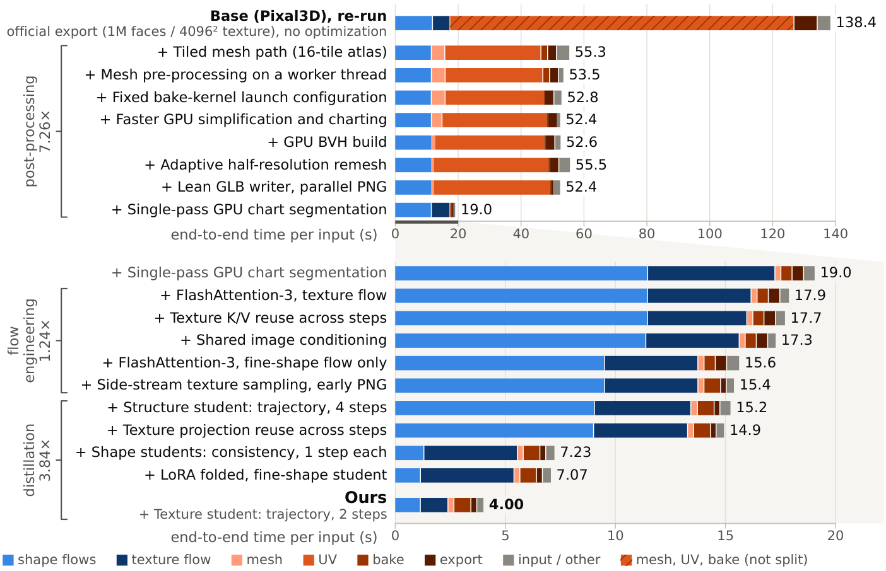
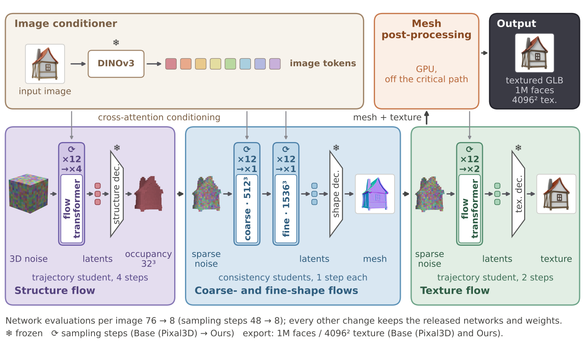

<h1 align="center">Sprint3D: Accelerating End-to-End 3D Asset Generation through Pipeline Optimization</h1>

<p align="center"><a href="https://alayalab.ai/"><b>Alaya Lab</b></a></p>

<p align="center">
  <a href="https://arxiv.org/abs/2611.16701"></a>
  <a href="https://alaya-lab.github.io/sprint3d/"></a>
  <a href="https://huggingface.co/AlayaLab/sprint3d"></a>
  <a href="LICENSE"></a>
</p>

<p align="center">
  
</p>

**Sprint3D turns one image into a textured 3D mesh (GLB, about 1M faces, 4096² texture) in 4.05 s on a
single NVIDIA H200: 33× faster than the released [Pixal3D](https://github.com/TencentARC/Pixal3D) pipeline it
is built on, at the same export settings, with better input-view normal maps on held-out Toys4K objects.**

Most of the time of such a pipeline is spent after its networks. Profiled stage by stage, the released Pixal3D
pipeline spends 14 % of its end-to-end time in its four rectified flows and 85 % in mesh post-processing, most
of it in CPU UV unwrapping. Sprint3D therefore

- rebuilds the mesh post-processing on the GPU, with a single-pass chart segmentation in place of the CPU UV
  unwrap, and takes it off the critical path: the geometry is processed on a worker thread while the texture
  flow samples;
- cuts the per-evaluation overhead of the unchanged flows (conditioning computed once, step-invariant keys,
  values and projections reused, FlashAttention-3);
- replaces the four flows by distilled *students*, LoRA adapters on the released flow models, cutting the
  network evaluations per image from 76 to 8.

The rebuilt post-processing is not specific to Pixal3D: on TRELLIS.2, which uses the same export code, it gives a
6.7× end-to-end speed-up without a detectable change in the evaluated metrics.

## News

- **[2026-11-13]** Technical report on [arXiv](https://arxiv.org/abs/2611.16701); code, [student
  weights](https://huggingface.co/AlayaLab/sprint3d) and the [project page](https://alaya-lab.github.io/sprint3d/)
  released.

## Results

**Speed.** Median end-to-end time per image, from reading the image to the closed GLB file, on one H200 over the
80 timing inputs (first 3 excluded as warm-up), both at the export settings of Pixal3D's own script (1,000,000
faces, 4096 × 4096 texture; protocol in [docs/TIMING.md](docs/TIMING.md)):

| Pipeline | End-to-end time | Network evaluations per image |
|---|---:|---:|
| Pixal3D (released, run with its own script) | 133.0 s | 76 |
| **Sprint3D** | **4.05 s** | **8** |

**Quality.** The protocol of the Pixal3D paper on the 2,653 objects of the Toys4K test part, evaluated once:
silhouette IoU and input-view normal maps against the ground truth (Table 4 of the report):

| Method | IoU ↑ | PSNR ↑ | SSIM ↑ | LPIPS ↓ | Mean (°) ↓ | Median (°) ↓ | Mean<sub>B</sub> (°) ↓ | 11.25° ↑ | 22.5° ↑ | 30° ↑ | E2E (s) ↓ |
|---|---:|---:|---:|---:|---:|---:|---:|---:|---:|---:|---:|
| TRELLIS.2 | 79.55 | 17.15 | 0.577 | 0.033 | 25.06 | 18.97 | 27.56 | 48.27 | 64.47 | 70.80 | – |
| TripoSG | 59.87 | 14.22 | 0.504 | 0.051 | 38.87 | 34.31 | 40.88 | 22.74 | 35.89 | 42.98 | – |
| Hunyuan3D-2.1 | 59.82 | 14.31 | 0.505 | 0.049 | 39.33 | 35.24 | 41.80 | 23.20 | 36.10 | 43.17 | – |
| Pixal3D (released) | **96.97** | 20.87 | 0.668 | 0.021 | 14.25 | 9.99 | 15.73 | 61.35 | 82.58 | 88.71 | 133.0 |
| **Sprint3D** | 96.78 | **21.56** | **0.712** | **0.018** | **13.00** | **9.06** | **14.33** | **65.53** | **85.13** | **90.40** | **4.05** |

Sprint3D is better than the released pipeline on every normal-map column, at a slightly lower mean silhouette
IoU. The speed-up is not free: outside this protocol, Sprint3D scores slightly but significantly lower under the
point-cloud encoders ULIP-2 and Uni3D, and it has less fine texture detail than the 12-step texture flow its
2-step student replaces. Both are discussed in the report.

**Where the time goes.** Each row of the cumulative measurement adds one change to the row above. In this
order, the speed-up splits into 7.3× for the rebuilt post-processing, 1.2× for the engineering of the unchanged
flows and 3.8× for distillation. The measurement starts from a re-run of the released pipeline inside our
measurement code (138.4 s) and ends at 4.00 s; the two times in the table above come from the dedicated timing
run.

<p align="center">
  
</p>

## How it works

<p align="center">
  
</p>

Sprint3D keeps the released Pixal3D networks, decoders and weights. Only the students are new: four LoRA adapters
(rank 256) on the flow transformers. The structure student samples in 4 steps and the texture student in 2
(trajectory distillation); the coarse- and fine-shape students sample in 1 step each (consistency
distillation). Everything else is systems work on the released pipeline. Each optimization added after the tiled
mesh path is a *lever*, a boolean field of `fastpixal3d.config.Levers`: [docs/LEVERS.md](docs/LEVERS.md) lists
the levers with their output class (identical, near-identical or output-changing), and
`scripts/infer.py --disable <name>` switches one off.

## Requirements

- Linux with an NVIDIA GPU and CUDA 12.8.
- The reported numbers use a Hopper GPU (sm_90). FlashAttention-3 needs sm_90; on other GPUs the package
  falls back to FlashAttention-2 (`--fa2`), which gives the same results up to rounding but is slower.
- Python 3.10 and PyTorch 2.7.0.
- Several source-built CUDA extensions (FlexGEMM, CuMesh, o-voxel, nvdiffrast, FlashAttention-3) and two patched
  native extensions from this repository.

## Installation

```bash
git clone --recursive https://github.com/AlayaLab/sprint3d.git && cd sprint3d
bash env/install.sh                       # conda environment, pinned packages, source builds, patched extensions
```

The installation takes 1 to 1.5 hours with 4 CPU cores and about 30 GB of disk. It works with conda, mamba or
micromamba, and `ENV_PREFIX=/path bash env/install.sh` puts the environment in a directory; when a step fails,
running the script again resumes at that step. `--recursive` fetches the pinned upstream submodules with their
own submodules (2.0 GB); only `third_party/Pixal3D` is needed to run inference.

| file | what it is |
|---|---|
| [`env/environment.yml`](env/environment.yml) | the environment |
| [`env/requirements-runtime.lock`](env/requirements-runtime.lock) | the exact package versions of the measured environment |
| [`env/build_fa3.sh`](env/build_fa3.sh) | builds FlashAttention-3 at the pinned commit |
| [`env/Dockerfile`](env/Dockerfile) | the same steps as a container recipe |

[docs/INSTALL.md](docs/INSTALL.md) describes every step, including how to build the patched native extensions
with `native/build_native.sh`.

## Weights

The student adapters are distributed from the Hugging Face model repository
[`AlayaLab/sprint3d`](https://huggingface.co/AlayaLab/sprint3d), pinned to one commit in
[`weights/sources.json`](weights/sources.json): the four deployed students and `students.json`
(5.19 GB). Pixal3D, MoGe-2 and RMBG-2.0 come from their own repositories and DINOv3 from a public
mirror, at pinned revisions; the NAF weights are a release file checked by sha256.
Pixal3D is gated in the EU and RMBG-2.0 is gated; accept their terms first. The package reads every model from the
directory these scripts fill (`weights/`, or `$FASTPIXAL3D_WEIGHTS`); RMBG-2.0 is needed only for input images
without an alpha channel.

```bash
python scripts/download_weights.py         # students from AlayaLab/sprint3d, upstream models at pinned revisions (about 32.6 GB in total)
python scripts/verify_weights.py           # size and sha256 of every file
```

[docs/WEIGHTS.md](docs/WEIGHTS.md) lists every file, its revision and its licence.

## Quick start: image to GLB

```bash
python scripts/infer.py --image third_party/Pixal3D/assets/images/4_img.png --output out/4_img.glb \
    --students weights/students --pixal3d weights/pixal3d --timing-json out/timing.json
```

- The GLB uses the export settings of Pixal3D's own script (1,000,000 faces, 4096 × 4096 texture).
- The Pixal3D repository includes 19 example images under `assets/images`. Inputs without an alpha channel are
  matted with RMBG-2.0.
- Next to the GLB, `infer.py` writes `<stem>.json` with the camera used for the input.
- `--timing-json` writes per-stage times.
- `--list inputs.jsonl --out-dir out/` processes many inputs in one process.
- The first request of a process is slower: it compiles kernels and tunes the sparse convolutions. Use
  `--warmup 1` (the default) before timing.

To produce the reference output, run Pixal3D's own script, unmodified and at its defaults:
`python scripts/run_official.py --image <image> --output <out>.glb`.

`bash scripts/check.sh` runs the CPU tests and one image through `infer.py` and prints a short summary;
use it to check an installation.

## Reproducing the report

| topic | where | state |
|---|---|---|
| timing protocol behind the numbers above (`scripts/time_e2e.py`, `scripts/analyze_timing.py`) | [docs/TIMING.md](docs/TIMING.md) | protocol of the two times in the speed table |
| evaluation of the report's tables (`eval/`); object lists with checksums and licences; no data is distributed | [docs/EVALUATION.md](docs/EVALUATION.md), [docs/DATA.md](docs/DATA.md) | `eval/make_table.py`, applied to the per-object results behind the report, reproduces the Pixal3D and Sprint3D rows of the validation-set table (Table 10 (a)) character for character, and the metric code matches the stored values on 3 validation objects; the ground-truth recipe is not verified ([docs/DATA.md](docs/DATA.md)); the Toys4K test list of the main table is not in this repository, the development list is |
| the cumulative measurement, ablations, TRELLIS.2 port and baselines (`experiments/`) | [docs/REPRODUCE_PAPER.md](docs/REPRODUCE_PAPER.md) | cumulative measurement re-run on the 80 timing inputs: final row 3.997 s against the measurement code's 4.005 s; the 95 % CI contains the measurement code's value on 15 of the 18 adjacent row pairs (same sign on 18 of 18), so the pre-registered criterion is not met ([docs/PARITY.md](docs/PARITY.md)). TRELLIS.2 port and baseline adapters: included, and the analysis scripts of the port reproduce the stored values of the report's run (`colour_metrics.py` on one input, `summarize_trellis2.py` on all 80); no run of the port or the baselines with this package is reported |
| retraining the four students (`data/`, `train/`) | [docs/TRAINING.md](docs/TRAINING.md) | trainers and cache builders of all four students; the shape students' consistency trainer matches the original training code on the CPU tests and passed a GPU smoke run; no full retraining has been run with it |
| agreement between this package and the internal measurement code, with criteria registered before the check | [docs/PARITY.md](docs/PARITY.md) | structure support and decoder-input latents identical on 80 / 80 inputs, end-to-end median −0.15 %; the face-count and texture criteria are not met as registered (74 / 80 and 77 / 80, the exceptions are listed there) |

## Repository layout

```
src/fastpixal3d/     inference package (pipeline, stages, students, mesh, export, runtime, official reference)
native/              patch series on pinned upstream commits (CuMesh, cubvh) and their build script
scripts/             infer.py, run_official.py, time_e2e.py, analyze_timing.py, parity_check.py, parity_run.sh,
                     download_weights.py, verify_weights.py
eval/                evaluation suite
data/                object selection scripts and object lists (no data)
train/               caches and trainers of the four students (trajectory and consistency distillation)
experiments/         cumulative measurement, ablations, TRELLIS.2 port, baselines
weights/             sources.json (pinned weight sources and checksums)
env/                 environment files, install script, FlashAttention-3 build, Dockerfile recipe
docs/                INSTALL, WEIGHTS, TIMING, EVALUATION, DATA, TRAINING, LEVERS, PARITY, REPRODUCE_PAPER
tests/               CPU tests and one GPU smoke test (pytest -q)
assets/              images of this page
third_party/         upstream repositories at pinned commits (git submodules)
```

## License

Sprint3D's own code (`src/`, `scripts/`, `eval/`, `data/`, `train/`, `experiments/`, `tests/`, `docs/`, the patch
files in `native/`) is released under the Apache License 2.0 (`LICENSE`, Copyright 2026 Alaya Lab); `NOTICE`
carries the attribution notices required by the licence. The student weights are released under
[CC BY-NC 4.0](https://creativecommons.org/licenses/by-nc/4.0/), because their training data includes assets under
non-commercial and research-only licences (`docs/WEIGHTS.md`, `docs/DATA.md`).

Running the full system also involves third-party components under **non-commercial** terms, whatever
licence this repository's own code has:

- nvdiffrast (texture baking and evaluation rendering): NVIDIA Source Code License;
- the cubvh code in the patched native extension built from `native/cubvh`: covered by its
  `LICENSE_NVIDIA` (NVIDIA Source Code License) in addition to MIT;
- RMBG-2.0 (background removal, used only for inputs without an alpha channel): CC BY-NC 4.0.

The DINOv3 weights (image conditioning) come under the DINOv3 License, which has its own conditions:
redistribution only under the same licence, acknowledgement in publications, and acceptable-use and trade-control
terms.

See [THIRD_PARTY_LICENSES.md](THIRD_PARTY_LICENSES.md) for all third-party components, their licences and the full
texts in `LICENSES/`.

## Acknowledgements

Sprint3D builds on the released code and weights of [Pixal3D](https://github.com/TencentARC/Pixal3D) and on
[TRELLIS.2](https://github.com/microsoft/TRELLIS.2), and uses CuMesh, FlexGEMM, o-voxel, nvdiffrast, cubvh, MoGe,
DINOv3, RMBG-2.0, NAF and FlashAttention, among the components listed in
[THIRD_PARTY_LICENSES.md](THIRD_PARTY_LICENSES.md). Sprint3D is not affiliated with, endorsed by or
reviewed by Tencent or the authors of Pixal3D.

## Citation

```bibtex
@misc{kuno2026sprint3d,
  title  = {Sprint3D: Accelerating End-to-End 3D Asset Generation through Pipeline Optimization},
  author = {Kuno, Sho and Yu, Ruihan and Yu, Yonghao and Lin, Guixu and Fu, Lian and Niu, Muyao and
            Tsai, Yu-Ju and Huang, Zheng-Hui and Huang, Yi-Chuan and Yang, Siqi and Lan, Fengbo and
            Wu, Erwin and Zhang, Kaipeng and Wang, Zhixiang},
  year   = {2026},
  eprint = {2611.16701},
  archivePrefix = {arXiv},
  primaryClass  = {cs.CV}
}
```

<details>
<summary><b>Notes on checkpoint loading, data files and network behaviour</b></summary>

* **Checkpoint loading:** the deployed students are safetensors files, verified by size and sha256 against
  `weights/sources.json`. Every `torch.load` in this package uses restricted deserialization
  (`weights_only=True`) by default; the loaders of training checkpoints, training records and the Uni3D / ULIP-2
  evaluation checkpoints fall back to full unpickling only when `FASTPIXAL3D_TRUST_CHECKPOINT=1` is set, and say
  so in their error message; the converter of training checkpoints (`fastpixal3d.students.convert`) does so only
  with `--allow-pickle`. PyTorch 2.7.0 is pinned (2.6 or newer includes the fix for CVE-2025-32434).
* **Pickle files:** `data/select/` reads the intermediate pickles that its own earlier steps wrote, and the
  evaluation and the cache builders read mesh dumps produced by the data preparation. Load only files you
  produced yourself or obtained from a trusted source.
* **Configuration parsing:** YAML is read with `yaml.safe_load`; command-line overrides are parsed as values, never
  evaluated as code.
* **Network behaviour:** no telemetry. With a complete weights directory, the inference path fetches only the
  model code of the NAF feature upsampler, through `torch.hub` at a pinned commit (as the upstream Pixal3D loader
  does). A model whose files are not all in the weights directory is loaded as Pixal3D's own code loads it, by hub
  id from the Hugging Face hub or `torch.hub` (Pixal3D itself at its pinned revision); `scripts/infer.py --offline`
  keeps the run from contacting the Hugging Face hub. All other downloads happen in the scripts that exist for
  that purpose: `scripts/download_weights.py` (Hugging Face repositories at pinned revisions and one GitHub release
  file, sha256 checked), `eval/fetch_metric_models.py` (Hugging Face, download.pytorch.org, dl.fbaipublicfiles.com
  and pinned GitHub commits, sha256 checked) and `env/install.sh` (conda-forge and nvidia channels, PyPI,
  download.pytorch.org, whl.natten.org, pinned GitHub commits, and Eigen from GitLab).
* **Processes:** subprocesses are started in list form without a shell (`git` for provenance and, in
  `eval/fetch_metric_models.py`, for fetching metric-model code at pinned commits; `nvidia-smi` and a Python child
  process for the timing sampler; the project's own scripts in `experiments/run_arms.py` and the GPU smoke test).
  `eval/tests/test_frames_projection.py` executes a function extracted from the pinned Pixal3D source.
* **Repository contents:** source, configurations, object lists, tests, documentation and the images of this page;
  no credentials, no weights, no datasets, no renders. `.gitignore` excludes `.env*`, `.netrc`, weight and cache
  files and the download directories under `weights/`.
* **Licence files:** `LICENSE`, `NOTICE` and `THIRD_PARTY_LICENSES.md` are declared in `pyproject.toml`
  (`license-files`) for source and wheel distributions.

</details>
